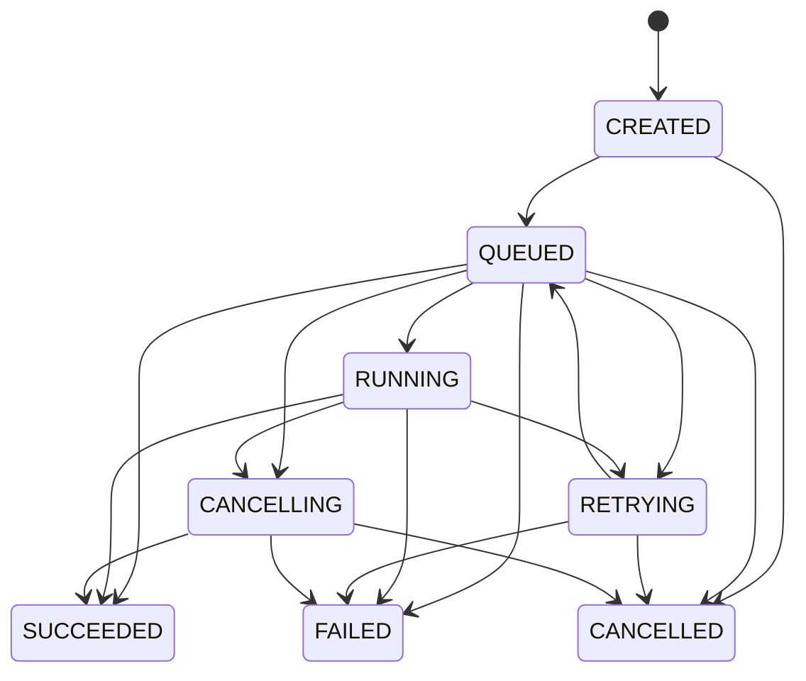

# Job lifecycle specification

The state machine is **domain-first**; it must not depend on FastAPI, SQLAlchemy or Ray.

## State meanings and scope

- `CREATED`: logical request exists before queue admission. The durable create API commits creation and queue admission together; it returns `QUEUED` and does not leave a stranded `CREATED` row.
- `QUEUED`: waiting for dispatch or for the executor to start training. An attempt may already have a persisted submission identity and may exist remotely. Attempt metadata distinguishes local waiting, pending execution and an unknown submission outcome.
- `RUNNING`: execution has been observed running. Queue wait and actual execution time are recorded separately.
- `RETRYING`: the previous attempt is known to have ended or been rejected; the controller is waiting for retry backoff. No earlier attempt may still be executing.
- `CANCELLING`: cancellation intent is durable, but a remote execution may still exist or a dispatch may still be in flight. No new attempt may be scheduled.

Enum members use uppercase names and lowercase string values, matching the API. Keep these eight states for MLP-001; attempt status and contextual guards belong to the controller milestones.

## Allowed transitions

| Current | Allowed next states |
|---|---|
| `CREATED` | `QUEUED`, `CANCELLED` |
| `QUEUED` | `RUNNING`, `SUCCEEDED`, `RETRYING`, `FAILED`, `CANCELLING`, `CANCELLED` |
| `RUNNING` | `SUCCEEDED`, `RETRYING`, `FAILED`, `CANCELLING` |
| `RETRYING` | `QUEUED`, `FAILED`, `CANCELLED` |
| `CANCELLING` | `CANCELLED`, `FAILED`, `SUCCEEDED` |
| `SUCCEEDED` | terminal |
| `FAILED` | terminal |
| `CANCELLED` | terminal |

## Invariants

1. Terminal states (`SUCCEEDED`, `FAILED`, `CANCELLED`) cannot transition to any other state (including self-transition).
2. `can_transition(current, new)` checks only the graph and is a pure function. `transition(current, new)` returns the new `JobStatus` or raises `InvalidJobTransition`; it does not mutate external state. Contextual guards below are additional service/controller checks.
3. Attempt history is a separate record. `RETRYING` represents retry scheduling before exhausting attempts; an exhausted job becomes `FAILED` and remains terminal.
4. Cancel completion is *not* implied by receiving a request. A worker can finish as cancellation is in flight; `CANCELLING -> SUCCEEDED` is deliberately allowed.
5. In the persistent implementation, use conditional state updates or optimistic version checks to prevent concurrent workers from committing conflicting transitions.
6. Job-level idempotency is distinct from execution attempts; retries preserve the logical job ID.

## Guards for persistent execution

- `QUEUED -> CANCELLED` is allowed only when no remote execution can exist and no dispatcher can still submit the work. Commit cancellation against the same job/attempt ownership checks used by dispatch. Once submission intent is committed, use `CANCELLING` until a stop or safe non-execution is confirmed.
- `QUEUED -> RETRYING/FAILED` handles confirmed submission rejection or execution failure before a running observation. `QUEUED -> SUCCEEDED` handles a short job that finishes between polls; require a verified successful result and completed artifact publication where applicable. MLP-007's dummy executor exercise does not yet produce a model.
- An HTTP timeout, expired controller lease or executor `UNKNOWN` is not proof of failure or cancellation. Reconcile the same submission identity; do not create a new attempt or report a terminal outcome based only on that signal.
- An executor `NOT_FOUND` observation alone cannot prove cancellation while an older dispatch request may still arrive. Keep cancellation intent and reconcile until dispatch is safely revoked or execution has an observed terminal outcome. Fence stale owners' database writes.
- A GPU-required job awaiting capacity remains `QUEUED` with a waiting reason. Waiting does not consume retry budget or silently change the workload to CPU.
- In `CANCELLING`, observed success may produce `SUCCEEDED`, confirmed stop produces `CANCELLED`, and observed failure produces `FAILED`. Do not retry after cancellation intent.

The graph contains 18 allowed edges across 64 state pairs. MLP-001 tests the graph, including all forbidden pairs; it does not prove transactional or remote cancellation safety. MLP-004/005/007 add the contextual and concurrency tests.

## Review prompts

- What if a worker completes after the user requests cancellation?
- Which controller writes the final state, and how does it learn the real execution outcome?
- Can a controller crash between submitting to Ray and committing the Ray job ID?
- What is the difference between job state and execution attempt state?

**First implementation task:** [MLP-001](../03-planning/tasks/MLP-001.md).
