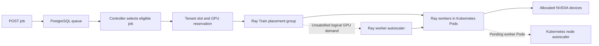

# GPU scheduling on Kubernetes

**DESIGN-ONLY** for NVIDIA device allocation and CUDA execution. The example
covers one dedicated GPU per Ray worker. The
[CPU test on kind](../06-engineering/kuberay-kind.md) covers the KubeRay
controller and Ray execution on CPU. The KUSANAGI NERV Ray Jobs adapter still
advertises zero GPUs. Running this example uses KubeRay directly.

## From device to worker

1. Provision a Linux node with a supported NVIDIA GPU and a driver compatible
   with the CUDA image. Configure the container runtime with NVIDIA
   Container Toolkit and the cluster's device injection mechanism. Use a
   GPU Operator-managed stack or reuse the compatible host components your
   node image already provides.
2. Run the NVIDIA device plugin. It advertises healthy devices in
   `status.allocatable` and provides the runtime information needed to expose
   the devices allocated to a container. Use the cluster's GPU RuntimeClass
   if its runtime configuration requires one.
   [Kubernetes device plugins](https://kubernetes.io/docs/concepts/extend-kubernetes/compute-storage-net/device-plugins/) ·
   [NVIDIA GPU Operator prerequisites](https://docs.nvidia.com/datacenter/cloud-native/gpu-operator/latest/getting-started.html)
3. Label the verified exclusive pool `kusanagi-nerv.io/gpu-pool=dedicated`.
   Keep this label on nodes whose `nvidia.com/gpu` units are full, exclusive
   devices. The worker tolerates a `NoSchedule` taint keyed `nvidia.com/gpu`.
   The selector constrains eligible nodes. The toleration permits placement
   on a tainted node and the resource request makes placement require a device.
   [Kubernetes GPU scheduling](https://kubernetes.io/docs/tasks/manage-gpus/scheduling-gpus/)
4. The [RayJob](../../deploy/gpu/ray-job.yaml) creates its own RayCluster.
   The worker requests and limits `nvidia.com/gpu: 1`. KubeRay uses the
   container's GPU limit to configure Ray's logical capacity. The submitter
   and head request CPU and memory. The head advertises zero logical GPUs.
   All three use the same pinned Ray 2.60.0 Python 3.12 CUDA image.
   [KubeRay resource configuration](https://docs.ray.io/en/latest/cluster/kubernetes/user-guides/config.html)
5. The [probe](../../deploy/gpu/gpu_probe.py) asks Ray for one GPU, checks the
   task's assigned ID, initializes the CUDA driver and requires one
   compute-capable device. It queries device metadata with `nvidia-smi`.
   [CUDA initialization](https://docs.nvidia.com/cuda/cuda-driver-api/cuda_driver_api/group__CUDA__INITIALIZE.html) ·
   [CUDA device enumeration](https://docs.nvidia.com/cuda/cuda-driver-api/cuda_driver_api/group__CUDA__DEVICE.html)
   The RayJob sets deadlines and shuts down its owned cluster
   after completion. A successful probe would establish device visibility
   from that task. CUDA kernel execution, NCCL and performance need their own
   tests on hardware.

## Capacity and admission



Assume a burst of 500 valid requests on eight four-GPU training nodes. One-GPU
jobs have an upper bound of 32 concurrent executions. Four-GPU jobs that
require one node have an upper bound of eight. CPU, memory, tenant quotas and
other workloads can lower both bounds. Eight free GPUs spread one per node
cannot fit a four-GPU same-node job.

Persist a valid request first and return `202` with its job ID. Choose among
eligible tenants with round-robin scheduling and FIFO within each tenant.
Permit smaller requests to backfill gaps. When an older large request reaches
its configured wait threshold, stop backfills that postpone the capacity
needed for it. Bound accepted queue depth separately from per-tenant active
jobs and GPU reservations.

For the [MLP-017 reservation design](data-model.md#tenant-reservations-mlp-017),
reserve the requested GPU count and an active-job slot transactionally before
dispatch. A local queued job has no reservation. A submitted job keeps its
reservation through pending placement, running, unknown execution state and
cancellation. Release on confirmed completion or safe non-execution. Retry
must acquire capacity again. Independent namespace
`ResourceQuota` entries such as `requests.nvidia.com/gpu` guard API admission
for Pods. They measure namespace resource requests. The tenant ledger controls
which logical jobs can dispatch.
[Kubernetes resource quotas](https://kubernetes.io/docs/concepts/policy/resource-quotas/#resource-quota-for-extended-resources)

| Observation | Response |
|---|---|
| Tenant has reached active-job or GPU quota | Keep accepted work queued with a quota wait reason. Re-evaluate when a reservation is released. |
| Requested shape is supported and currently unavailable | Keep work queued while capacity grows or frees up. Distinguish aggregate shortage from a topology mismatch. Reject an unsupported shape during admission. |
| Kubernetes rejects Pod creation because of namespace quota | Inspect the KubeRay events and namespace quota. Report this as admission failure or wait for known quota relief. |
| Pod stays Pending with `FailedScheduling` | Inspect node allocatable resources, affinity, taints, and the scheduler event. Reasons include absent GPUs, full devices, and insufficient CPU or memory on eligible nodes. |
| Pod is assigned but device setup or image startup fails | Inspect kubelet and container events and verify driver, toolkit and plugin configuration. An assigned Pod can fail before Ray registers a worker. |
| Ray placement group is pending on healthy Pods | Compare requested bundles, logical Ray resources and required topology. Report training as running only after worker start evidence. |

Serve scales model replicas from traffic and latency signals. Ray can add
worker Pods when logical resource demand cannot be met. Kubernetes node
autoscaling can add capacity when those Pods cannot be scheduled and a
compatible node group can expand. Keep latency-sensitive serving capacity
separate from batch training queues. The example uses one fixed GPU worker.
[Ray GPU autoscaling](https://docs.ray.io/en/latest/cluster/kubernetes/user-guides/gpu.html)

## Dedicated devices, MIG and time slicing

| Pool | Scheduling unit and isolation | Use in this design |
|---|---|---|
| Dedicated | `nvidia.com/gpu` is one full GPU with its own device memory. | Default for multi-rank DDP or FSDP and training with predictable performance requirements. |
| MIG | A supported GPU exposes profiles with fixed compute and memory slices and hardware memory and fault isolation between instances. Mixed mode provides specific names such as `nvidia.com/mig-1g.5gb`. Single-profile mode can advertise instances as `nvidia.com/gpu`. | Use profile-specific pools for jobs that fit the slice. Qualify the exact GPU, profile, driver, framework and communication stack before using distributed collectives. |
| Time slicing | A plugin can advertise multiple logical replicas of one device. Processes share memory capacity and faults. Requesting a replica gives no fixed fraction of throughput. | Use for tolerant exploratory workloads. Expose a distinct class such as `nvidia.com/gpu.shared` with `renameByDefault`. Charge shared units separately and keep them out of the dedicated DDP pool. |

Validate the device type separately from the resource name. Ray's logical
`GPU` allocation and the tenant quota must agree with the selected pool and
resource unit when adding MIG or shared profiles.
[NVIDIA MIG configuration](https://docs.nvidia.com/datacenter/cloud-native/gpu-operator/latest/gpu-operator-mig.html) ·
[NVIDIA GPU time slicing](https://docs.nvidia.com/datacenter/cloud-native/gpu-operator/latest/gpu-sharing.html)

## DDP and topology

The [training workload](../06-engineering/ray-train.md) asks for one GPU per
rank and selects NCCL for CUDA. Give each NCCL process exclusive access to its
device. DDP replicates model state and synchronizes gradients. FSDP shards
model state to reduce per-rank memory and adds communication to gather and
redistribute shards. Benchmark the model and interconnect before choosing.
[PyTorch distributed communication](https://docs.pytorch.org/docs/stable/distributed.html) ·
[PyTorch FSDP](https://docs.pytorch.org/docs/2.15/fsdp.html)

Use a Ray placement group to reserve the entire rank group. For four GPUs
that must share one host, give one Ray worker Pod four devices from an eligible
node pool and use `STRICT_PACK` for the rank bundles. Ray packs onto a single
Ray node, which is one Ray Pod in this setup. For multiple hosts, use a
verified GPU and interconnect class and explicit Kubernetes placement constraints
when physical separation is required. `STRICT_SPREAD` spans Ray nodes.
GPU topology within one host and the actual NVLink, PCIe or network path
need independent verification.
[Ray placement groups](https://docs.ray.io/en/latest/ray-core/scheduling/placement-group.html)

## Allocation, utilization and verification

Measure queue wait and placement wait separately. Count reserved GPU units
from the tenant ledger. Compute allocated GPU-hours from the observed device
allocation interval, then multiply by the configured price for that class to
produce an estimate. Track unallocated node time separately for fleet cost.
Use DCGM telemetry for device utilization and memory use. Per-container
attribution has additional limitations in time-sliced pools.
[NVIDIA DCGM Exporter](https://docs.nvidia.com/datacenter/dcgm/latest/installation/install-dcgm-exporter.html) ·
[NVIDIA time-slicing limitations](https://docs.nvidia.com/datacenter/cloud-native/gpu-operator/latest/gpu-sharing.html#limitations)

With KubeRay installed and the review namespace created, validate the schema
on the intended cluster using its explicit context.

```bash
kubectl --context "$gpu_context" apply --dry-run=server --validate=strict -k deploy/gpu
```

The [local validation](../03-planning/progress.md#2026-11-18--mlp-016--gpu-resource-contract)
also used the rendered worker template as a native Pod. This exercised
Kubernetes resource validation and confirmed a `FailedScheduling` event
when the only eligible node had zero allocatable GPUs.

On a dedicated, approved GPU test cluster, inspect the pool nodes' allocatable
`nvidia.com/gpu` and then apply the example. Inspect it before the RayCluster's
post-completion cleanup. The submitter Job retains the probe output under the
normal KubeRay cleanup policy.

```bash
kubectl --context "$gpu_context" apply -k deploy/gpu
kubectl --context "$gpu_context" -n kusanagi-gpu get rayjob,raycluster,pods -o wide
kubectl --context "$gpu_context" -n kusanagi-gpu logs job/gpu-probe
```

Record the GPU model, visible device count, driver, CUDA/PyTorch configuration,
and device metrics for any execution or performance claim. Use
[MLP-022](../03-planning/tasks/MLP-022.md) for a measured CUDA training run.
