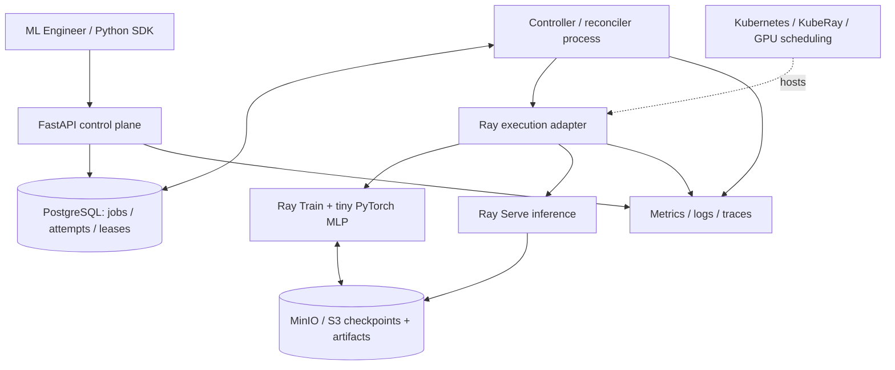

# Architecture and reliability contract

## Architectural decisions

1. **Two planes, separate processes.** Control plane performs validation and state changes; controller reconciles jobs; Ray performs compute. Do not execute training in HTTP handlers or in-process FastAPI `BackgroundTasks`.
2. **Durable database + separate dispatcher.** Use PostgreSQL as the source of truth. Claim queued rows via safe leasing / transactions (`SELECT ... FOR UPDATE SKIP LOCKED` is one option). Reconcile on process restarts. For learning scope, postpone Kafka/Redis until a demonstrated need exists.
3. **At-least-once dispatch.** Controller crashes between dispatching Ray and writing state are unavoidable; persist a stable Ray Jobs `submission_id` before dispatch and reconcile by it after restart. Make repeated controller operations idempotent while keeping terminal state transitions forbidden. Don't promise exactly-once effects.
4. **Attempt records.** `jobs` represents logical intent; `job_attempts` records executions, start/end times, Ray IDs, errors and checkpoint URIs. Job status alone is not an audit log.
5. **Checkpoints in object storage.** Model, optimizer, epoch and config state must be enough to resume. File persistence alone is not recovery: verify restore through a failure drill.
6. **Cancellation is best effort.** `CANCELLING` can race against `SUCCEEDED`; controller must resolve the actual worker outcome and avoid reporting a stop that never happened.
7. **Multi-tenancy.** API authentication maps user to tenant; restrict access in DB; allocate worker slots / GPU resource requests by tenant policy, with fairness and quotas.
8. **GPU scaling layers.** (a) Ray Serve replicas, (b) Ray/KubeRay worker pods, (c) Kubernetes cluster nodes; these are distinct autoscalers and queues. Training placement differs from inference latency scaling.
9. **Resource requests vs utilization.** Scheduler allocates based on declared GPU logical resources, not DCGM utilization alone. NVIDIA device plugin exposes resource names; GPU hardware availability is separately verified.
10. **Cost visibility.** Estimate GPU-cost as allocated GPU count × duration × configured rate and label this an estimate, not a cloud bill.

## Readiness roadmap

- **Day 3:** one API + PostgreSQL row, real transaction, no compute.
- **Day 5:** worker controller and retries, durable records, cancellation.
- **Day 7:** first Ray job.
- **Day 10:** Ray Train + real checkpoint resume.
- **Day 13:** trained model served by Ray Serve.
- **Day 16+:** KubeRay manifests, GPU scheduling, multi-tenant fairness, metrics and load tests.

## Flyte vs Ray

**Ray is the runtime for this implementation.** Flyte is analyzed in a design note / optional small workflow, not deployed in parallel. Explain DAG/workflow control vs distributed Python task execution, retries, caching, dynamic jobs, operational tradeoffs, and when the two complement each other.
